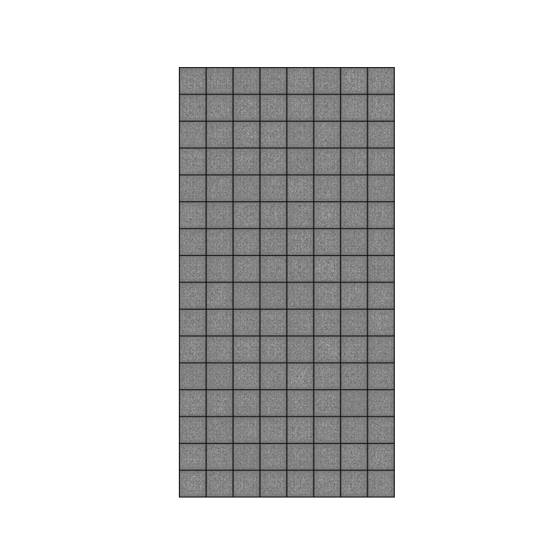

# DCGAN — Handwritten Digit Generation

A from-scratch PyTorch implementation of a **Deep Convolutional Generative Adversarial Network (DCGAN)** trained on **MNIST** to generate 64×64 grayscale handwritten digits from random noise.



*Generator samples on a fixed noise vector as training progresses.*

## Overview

This repo contains a complete DCGAN workflow:

- **Training notebook** (`GAN_implementation.ipynb`) — dataset loading, model definitions, weight initialization, the adversarial training loop, and loss/sample visualization.
- **Reusable model code** (`model.py`) — the exact `Generator` and `Discriminator` architectures used for training, plus a checkpoint loader.
- **Inference script** (`inference.py`) — loads the trained weights, samples 16 digits in a 4×4 grid, and optionally scores them with the discriminator. It creates `output/` on demand and resolves its paths relative to the script, so it runs from any directory.
- **Pre-trained checkpoints** — `weights/generator.pth` and `weights/discriminator.pth`, ready to use without retraining.
- **Training animation** — `dcgan_training.gif`, generated from snapshots taken during training.

The generator maps a 100-dimensional latent vector to a 1×64×64 image. The discriminator is a convolutional classifier trained to tell real MNIST digits from generated ones. Both networks are trained together using binary cross-entropy and the two-player minimax objective.

## Architecture

### Generator

| Layer | Operation | Output shape |
| ----- | --------- | ------------ |
| Input | Latent vector `z` | 100×1×1 |
| 1 | `ConvTranspose2d(100 → 512, 4×4, stride 1)` + BatchNorm + ReLU | 512×4×4 |
| 2 | `ConvTranspose2d(512 → 256, 4×4, stride 2, pad 1)` + BatchNorm + ReLU | 256×8×8 |
| 3 | `ConvTranspose2d(256 → 128, 4×4, stride 2, pad 1)` + BatchNorm + ReLU | 128×16×16 |
| 4 | `ConvTranspose2d(128 → 64, 4×4, stride 2, pad 1)` + BatchNorm + ReLU | 64×32×32 |
| Output | `ConvTranspose2d(64 → 1, 4×4, stride 2, pad 1)` + Tanh | 1×64×64 |

### Discriminator

| Layer | Operation | Output shape |
| ----- | --------- | ------------ |
| Input | Image | 1×64×64 |
| 1 | `Conv2d(1 → 64, 4×4, stride 2, pad 1)` + LeakyReLU(0.2) | 64×32×32 |
| 2 | `Conv2d(64 → 128, 4×4, stride 2, pad 1)` + BatchNorm + LeakyReLU(0.2) | 128×16×16 |
| 3 | `Conv2d(128 → 256, 4×4, stride 2, pad 1)` + BatchNorm + LeakyReLU(0.2) | 256×8×8 |
| 4 | `Conv2d(256 → 512, 4×4, stride 2, pad 1)` + BatchNorm + LeakyReLU(0.2) | 512×4×4 |
| Output | `Conv2d(512 → 1, 4×4, stride 1)` + Sigmoid | scalar probability |

> A `.pth` file stores weights only, not the model shape. `model.py` mirrors the notebook architecture exactly, so keep them in sync if you change the networks.

## Project structure

```text
GAN/
├── GAN_implementation.ipynb      # Training notebook (MNIST + DCGAN)
├── model.py                      # Generator, Discriminator, load_weights
├── inference.py                  # Inference / sampling script
├── train.py                      # Thin CLI entry point -> dcgan/
├── dcgan/                        # Training package
│   ├── cli.py                    # Orchestrates a run (single run or sweep)
│   ├── config.py                 # Config dataclass, argument parsing, W&B overrides
│   ├── runtime.py                # Device selection, seeding, cudnn
│   ├── data.py                   # MNIST DataLoader (workers, pinning, prefetch)
│   ├── training.py               # The adversarial training loop
│   ├── checkpoint.py             # Save / load / resume
│   ├── tracking.py               # Weights & Biases helpers
│   ├── sweep.py                  # W&B sweep agent
│   ├── artifacts.py              # Weights, loss curve, history.json
│   ├── paths.py                  # Repo-relative defaults
│   └── state.py                  # History container
├── sweep.yaml                    # W&B hyperparameter sweep definition
├── kaggle/                       # `kaggle kernels push` entry point (T4 GPU)
├── weights/                      # Checkpoints used by inference.py
│   ├── generator.pth             # Trained generator weights (~14 MB)
│   └── discriminator.pth         # Trained discriminator weights (~11 MB)
├── output/                       # Generated grids and training artifacts (runtime)
├── checkpoints/                  # Resumable .pt files (runtime)
├── dcgan_training.gif            # Training progress animation
├── pyproject.toml                # Project metadata and dependencies (uv)
├── uv.lock                       # Locked dependency versions
└── README.md
```

## Getting started

### Prerequisites

- Python **3.13+**
- [uv](https://docs.astral.sh/uv/) (recommended) or a plain Python environment with `pip`

### Installation

```bash
git clone https://github.com/Irfan140/GAN.git
cd GAN
uv sync
```

`uv run` will also install dependencies automatically on first use.

## Generating images

`inference.py` loads the generator, samples 16 random latent vectors (seed 42), saves them as a 4×4 grid, and prints the discriminator's mean score for the fakes.

The checkpoints are committed under `weights/`, and `inference.py` creates `output/` itself, so there is nothing to set up:

```bash
uv run inference.py
```

> `inference.py` resolves `WEIGHTS_DIR` and `OUTPUT_DIR` relative to its own location, so it works regardless of the directory you launch it from. Point `WEIGHTS_DIR` elsewhere if your checkpoints live outside `weights/`.

Output:

```text
Generator loaded
Discriminator loaded
Discriminator score for fake images (0 = fake, 1 = real):
Mean score: 0.xxxx
Saved to <repo>/output/generated.png
```

The generated grid is written to `output/generated.png` — the folder is created automatically on first run — and also displayed with Matplotlib. Inference runs on CPU, so no GPU is required.

## Training

Open `GAN_implementation.ipynb` in Jupyter, JupyterLab, or Google Colab and run all cells. MNIST is downloaded automatically to `./data`.

The notebook was trained on a Colab T4 GPU. `CUDA` is set to `False` in the configuration cell by default; set it to `True` (together with a CUDA-enabled PyTorch install) to train on GPU.

### Training from the command line

`train.py` is a thin entry point over the `dcgan/` package — a headless version of the notebook with the same defaults, importing the architectures from `model.py`:

```bash
uv run train.py                                # 5 epochs, batch 128, seed 1
uv run train.py --epochs 20 --device cuda      # longer run on a GPU
uv run train.py --resume                       # continue from checkpoints/latest.pt
```

It writes `weights/generator.pth` and `weights/discriminator.pth` (exactly what `inference.py` loads), sample grids to `output/training/samples/`, a loss curve to `output/training/loss_curve.png`, per-iteration losses to `output/training/history.json`, and resumable state to `checkpoints/`.

What it adds on top of the notebook:

- **Mixed precision** — `--amp` (on by default) uses fp16 autocast plus a gradient scaler on CUDA, typically 1.5–2× faster than fp32 on a T4. Ignored on CPU.
- **Parallel data loading** — `--num-workers` (use `4` on Kaggle) with pinned memory, persistent workers, and 2-batch prefetching.
- **Checkpointing** — `latest.pt` every `--checkpoint-every` batches (default 500) and `epoch_XXX.pt` at every epoch boundary. Each file holds both networks, both Adam states, the AMP scaler, RNG state, and the loss history, so `--resume` picks up at the exact batch.
- **Experiment tracking** — `--wandb-project NAME` logs losses, sample images, and final metrics to Weights & Biases; `sweep.yaml` defines a Bayesian hyperparameter search.

> Training with the defaults overwrites `weights/*.pth`. Use `--weights-dir` and `--output-dir` to keep experiments apart.

### Training on Kaggle (T4)

`kaggle/` contains a push-ready script kernel that clones this repo, installs `wandb`, and trains on the T4 with `/kaggle/working` as the output root:

```bash
# Requires ~/.kaggle/kaggle.json (your Kaggle API token)
kaggle kernels push -p kaggle
kaggle kernels status irfan140/gan-dcgan-training
kaggle kernels output irfan140/gan-dcgan-training -p kaggle-output
```

Add `WANDB_API_KEY` under **Add-ons → Secrets** in the notebook settings; `train.py` reads it via `kaggle_secrets` (or the `WANDB_API_KEY` environment variable) automatically.

Kaggle sessions are capped (9 h CPU, 12 h GPU). Since checkpoints are written under `/kaggle/working/checkpoints`, a run that hits the limit can continue later: download that folder, attach it as a Kaggle dataset, and add

```python
"--resume", "/kaggle/input/<dataset>/latest.pt"
```

to `ARGS` in `kaggle/train_kernel.py`.

### Hyperparameter tuning with W&B

```bash
uv run train.py --sweep-config sweep.yaml --sweep-count 8 --wandb-project gan-dcgan
```

The agent searches `lr` (log-uniform 1e-4–4e-4), `beta1` (0 or 0.5), and `batch_size` (64/128/256) for 10 epochs per trial, ranking runs by `final/loss_G` — the mean generator loss over the last 100 iterations. Every trial writes to `output/training/trial_<id>/`, so checkpoints and samples never collide. The same command works on Kaggle once `WANDB_API_KEY` is available.

### Training hyperparameters

| Parameter | Value |
| --------- | ----- |
| Dataset | MNIST |
| Image size | 64×64, grayscale |
| Batch size | 128 |
| Latent dimension (`Z_DIM`) | 100 |
| Generator / discriminator features | 64 |
| Epochs | 5 |
| Optimizer | Adam (`lr=2e-4`, `betas=(0.5, 0.999)`) |
| Loss | Binary cross-entropy |
| Real / fake labels | 1 / 0 |
| Weight init | Conv: `N(0, 0.02)`, BatchNorm: `N(1, 0.02)`, bias `0` |
| Seed | 1 |

During training the notebook logs `Loss_D`, `Loss_G`, `D(x)`, and `D(G(z))` every 50 iterations, stores a fixed-noise sample grid every 500 iterations, and plots real vs. generated images at the end. `train.py` logs the same values every `--log-every` batches and saves the grids and loss curve to disk instead of plotting interactively.

### Recreating the GIF

The **Save the progress as GIF** cell assembles the stored sample grids into `dcgan_training.gif` using Matplotlib's `ArtistAnimation`. It requires **ImageMagick** to be installed and on `PATH` because it uses the `imagemagick` writer. Change the writer to `pillow` if you prefer not to install ImageMagick.

## Notes

- The trained checkpoints are tied to the notebook's architecture and 64×64 input size.
- `load_weights()` in `model.py` tolerates both plain state dicts and checkpoints saved with a `DataParallel` `module.` prefix.
- Generated images use `Tanh` output in the range `[-1, 1]`; they are normalized for display and saving.
- `inference.py` builds its paths from `BASE_DIR = Path(__file__).resolve().parent` and calls `OUTPUT_DIR.mkdir(parents=True, exist_ok=True)` before saving, so it never fails on a missing `output/` folder.
- `train.py` trains on a single GPU (`cuda:0`). The D and G updates are inherently sequential, so DataParallel/DDP would add complexity for little gain at this model size — use `--amp` and more DataLoader workers instead.

## Author

**Irfan Mehmud** — [@Irfan140](https://github.com/Irfan140)
